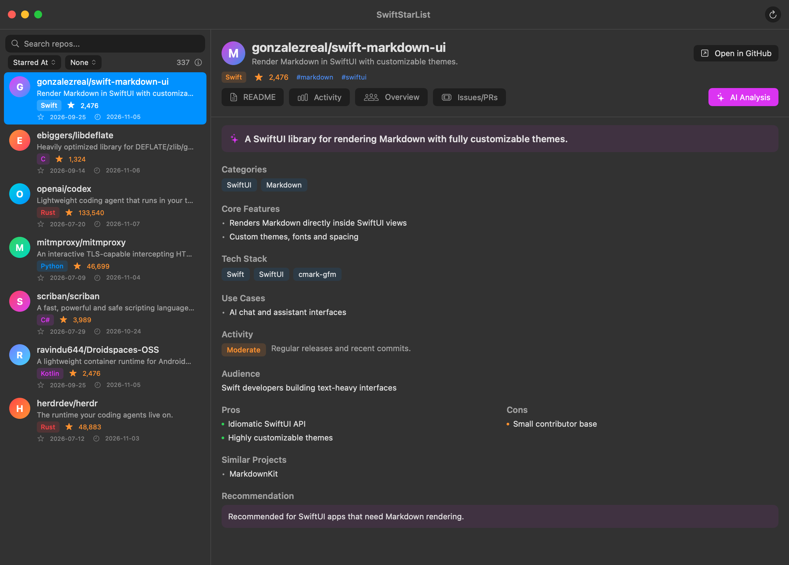
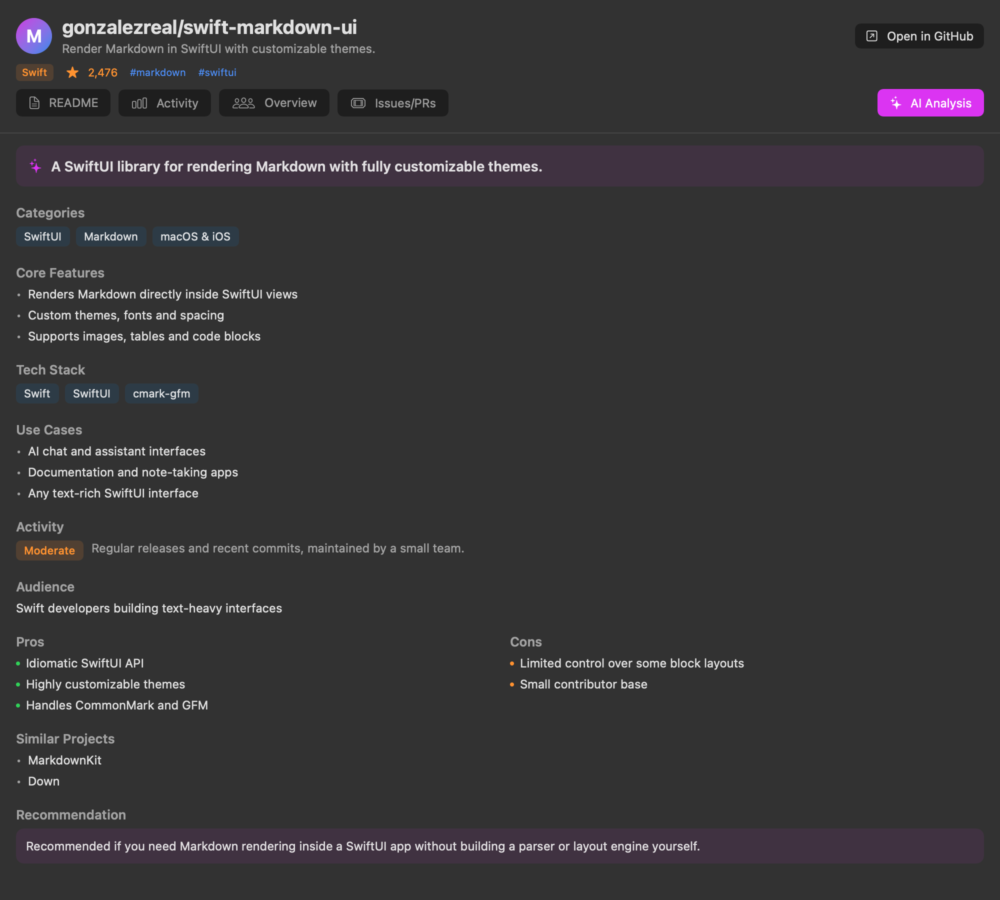
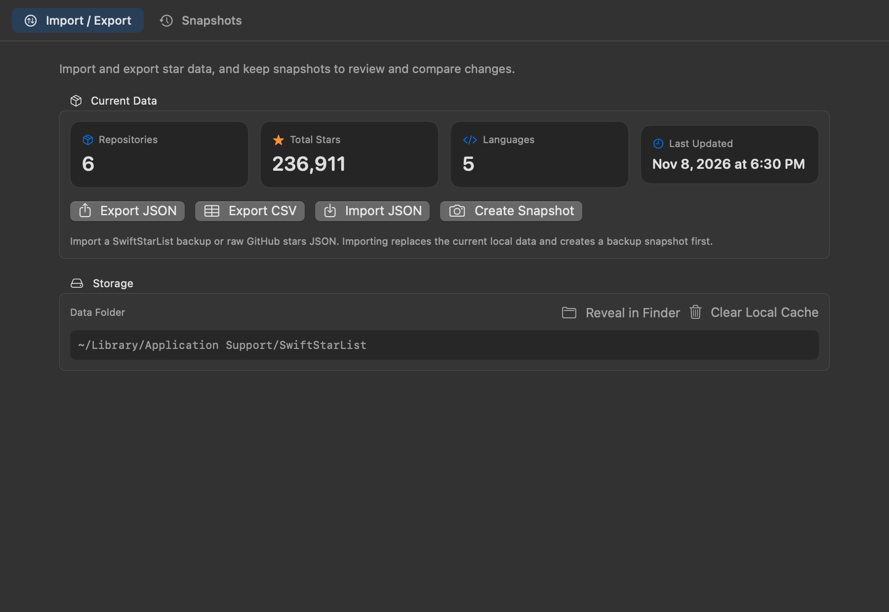
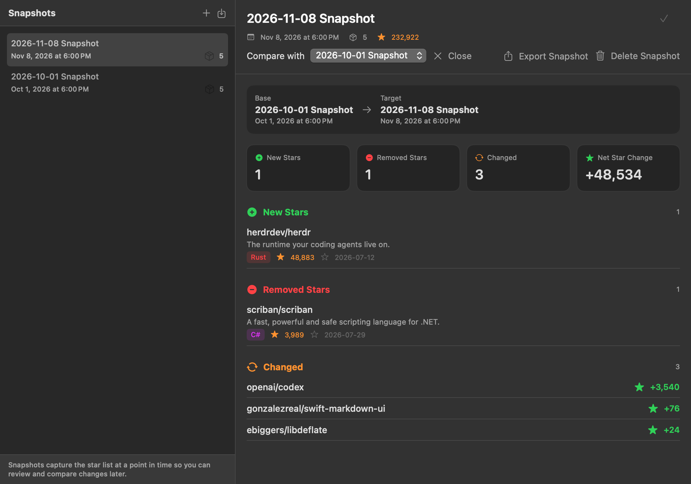
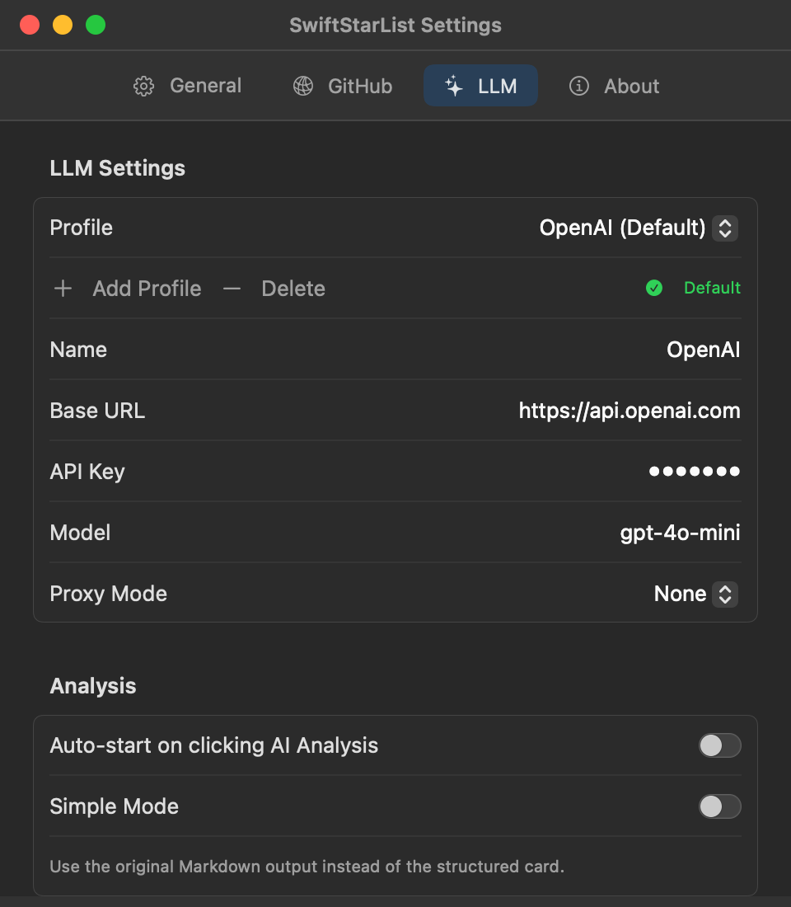
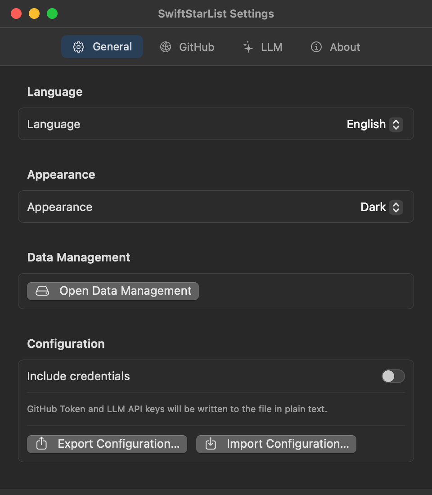
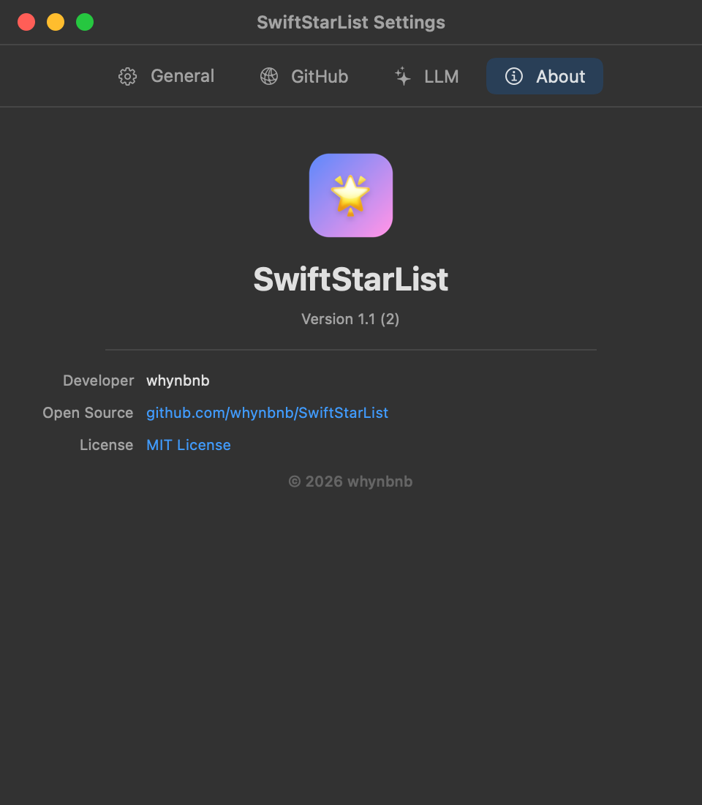

<p align="center">
  
</p>

# SwiftStarList

English | [简体中文](README.zh-CN.md)

[GitHub](https://github.com/whynbnb/SwiftStarList) · [MIT License](LICENSE)

> Vibe-coded with DeepSeek V4.1 Flash / OpenCode

A native macOS app for managing GitHub stars, with AI-powered repository analysis.



## Features

- Browse all of your GitHub starred repositories
- Search by name, language, topic, or description
- Sort and group by starred date, language, first letter, star count, and more
- Read repository READMEs with native Markdown rendering
- AI analysis through OpenAI-compatible APIs
  - Multiple custom LLM profiles with a selectable default
  - Structured analysis cards rendered progressively while streaming
  - Optional simple mode with plain Markdown output
  - Additional custom prompt for focus areas or style
- Proxy support: system, HTTP, and SOCKS5
- Local caching for repository data and avatars
- Import and export star data as JSON or CSV
- Snapshots with side-by-side change comparison

## AI Analysis



## Data Management

Import and export your star data, and keep snapshots to review how your stars change over time.





## Setup

Configure your GitHub Token and at least one LLM profile before first use:



The GitHub Token is required to read your starred repositories. The LLM configuration is only needed for AI analysis. Credentials are stored locally at:

```
~/Library/Containers/me.whynbnb.SwiftStarList/Data/Library/Application Support/SwiftStarList/credentials.json
```

The file is created with `0600` permissions.

If you use a local LLM service or a proxy on your LAN, macOS may ask for Local Network access. After changing the bundle identifier, grant it again in System Settings → Privacy & Security → Local Network.

The whole configuration can be exported and imported from Settings → General. Credentials are excluded by default and can be included explicitly.



## Build

```bash
# SPM
swift build
swift run

# Xcode
xcodebuild -scheme SwiftStarList build
# or open SwiftStarList.xcodeproj
```

Requires macOS 15 or later and Swift 6.

## Screenshots

Screenshots in `docs/` are generated from the app's SwiftUI components:

```bash
./scripts/render-screenshots.sh
```

## Dependencies

- [MarkdownUI](https://github.com/gonzalezreal/swift-markdown-ui) - Markdown rendering

## About



- Developer: [whynbnb](https://github.com/whynbnb)
- Version: 1.1 (2)
- Open source: https://github.com/whynbnb/SwiftStarList
- License: [MIT](LICENSE)

## License

[MIT](LICENSE) © 2026 whynbnb
