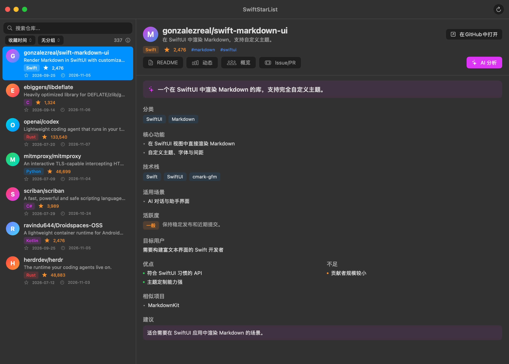
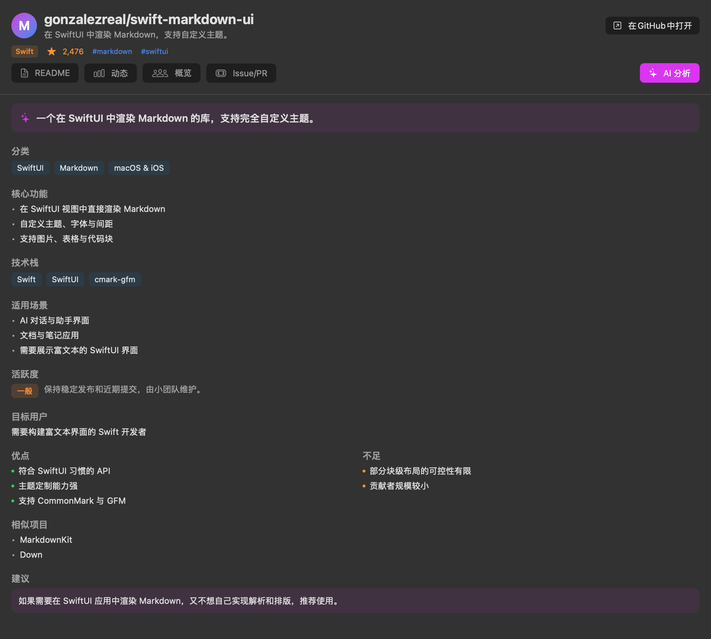
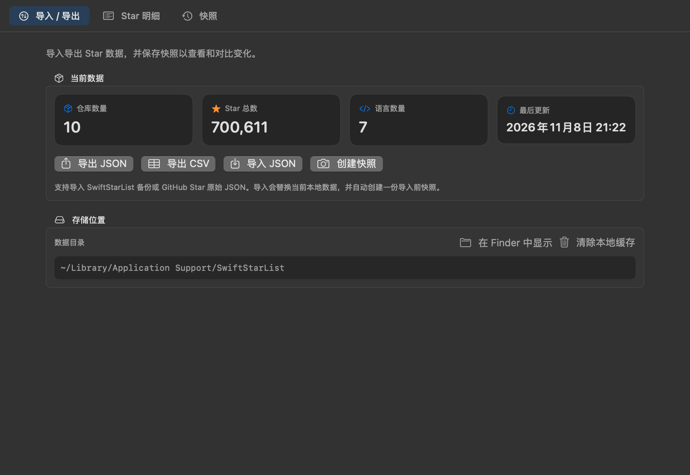
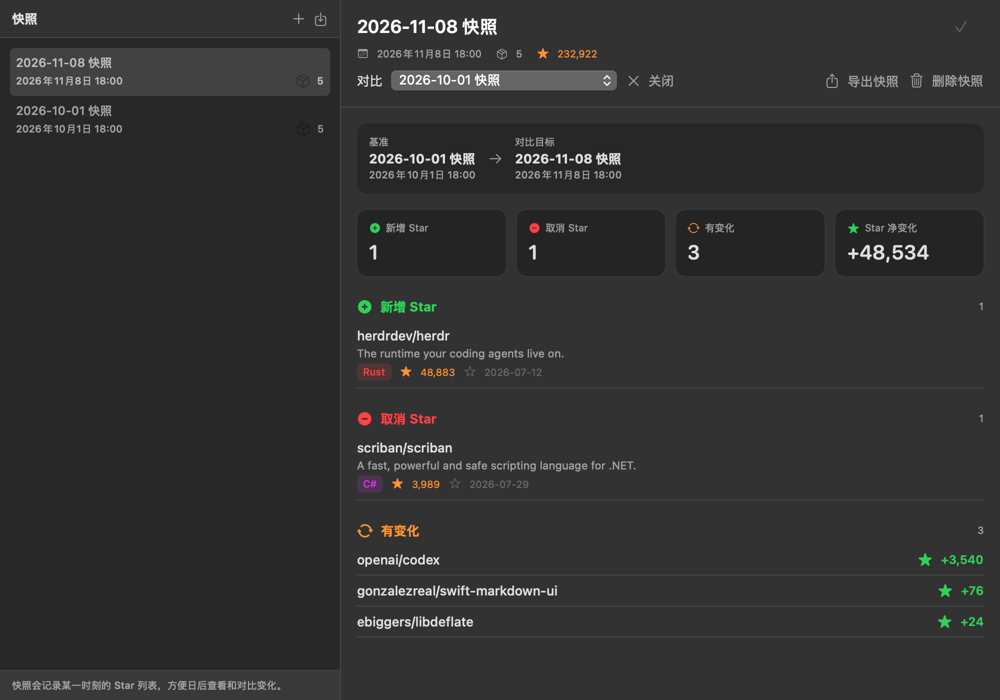
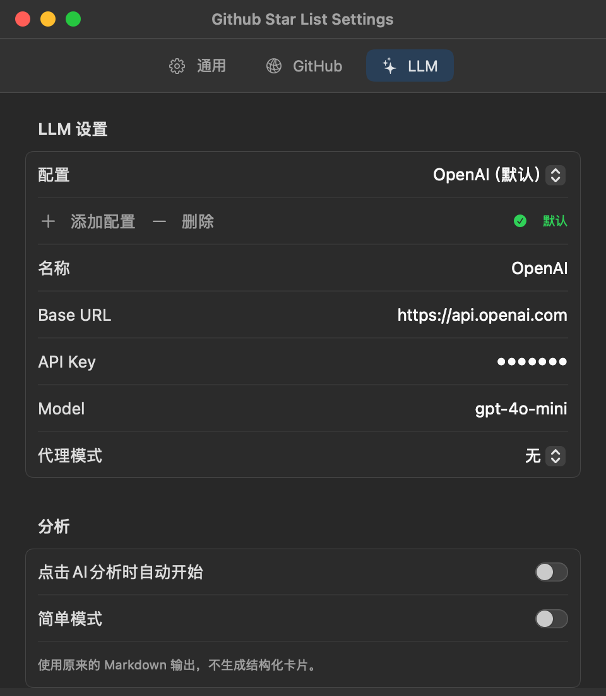
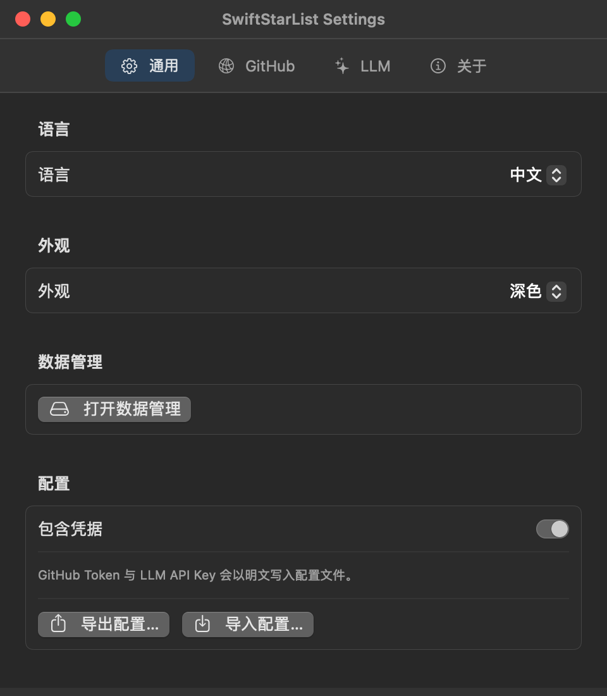

<p align="center">
  
</p>

# SwiftStarList

[English](README.md) | 简体中文

> Vibe Coding而成（DeepSeek V4.1 Flash / OpenCode）

一款 macOS 原生 GitHub Star 管理工具，支持 AI 智能分析。



## 功能

- 浏览所有 GitHub Star 仓库
- 按名称、语言、标签、描述搜索
- 按收藏时间、语言、首字母、Star 数等排序与分组
- 原生 Markdown 渲染查看仓库 README
- 基于 OpenAI 兼容接口的 AI 分析
  - 多个自定义 LLM 配置，可指定默认配置
  - 结构化分析卡片，流式生成并逐步渲染
  - 可选简单模式，使用普通 Markdown 输出
  - 支持附加提示词，自定义关注点或输出风格
- 代理支持：系统代理、HTTP、SOCKS5
- 仓库数据与头像本地缓存
- Star 数据 JSON / CSV 导入导出
- 快照保存与变化对比

## AI 分析



## 数据管理

导入导出 Star 数据，并通过快照查看和对比 Star 列表随时间的变化。





## 使用前设置

首次使用前，请先配置 GitHub Token 和至少一个 LLM 配置：



GitHub Token 用于读取你的 Star 仓库，LLM 配置仅在 AI 分析时使用。凭据保存在本地：

```
~/Library/Containers/com.swiftstarlist.app/Data/Library/Application Support/SwiftStarList/credentials.json
```

文件权限为 `0600`。

完整配置可在 设置 → 通用 中导出和导入。默认不包含凭据，可手动勾选包含。



## 构建

```bash
# SPM
swift build
swift run

# Xcode
xcodebuild -scheme SwiftStarList build
# 或双击 SwiftStarList.xcodeproj
```

需要 macOS 15 或更高版本，并使用 Swift 6。

## 截图

`docs/` 中的截图由应用的 SwiftUI 组件离屏生成：

```bash
./scripts/render-screenshots.sh
```

## 依赖

- [MarkdownUI](https://github.com/gonzalezreal/swift-markdown-ui) - Markdown 渲染

## License

[MIT](LICENSE) © 2026 0x574859
